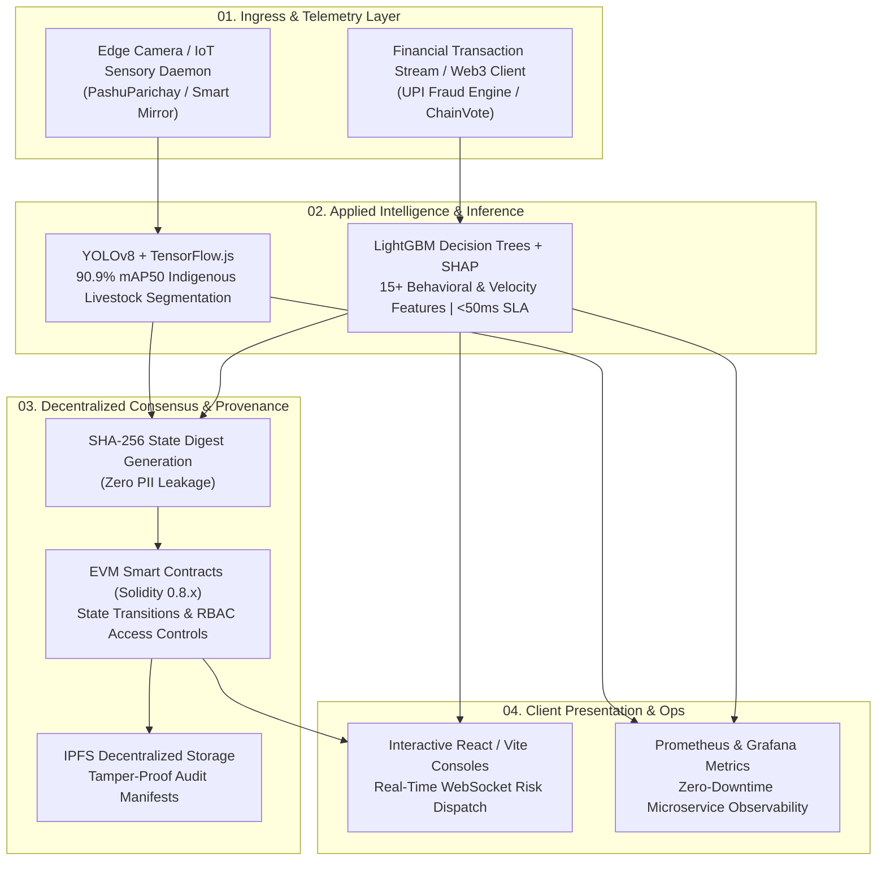

<div align="center">

# Kushal A M
### Distributed Systems · Applied AI & Computer Vision · Cryptographic Protocols
**B.Tech in Computer Science & Engineering (Blockchain) · Presidency University, Bangalore (2022–2026)**

[](https://linkedin.com/in/ku5hal)
[](https://github.com/kam-hq)
[](mailto:indexkam@gmail.com)

<br/>

> *"We’re making the world a better place through technology, one algorithm at a time, disrupting everything that came before us."*  
> *— Veni. Vidi. Vici.*

</div>

---

### $ kam-hq --system-telemetry --verbose

```
+-----------------------+-------------------------------------------------------------+
| Telemetry Parameter   | Active System Value                                         |
+-----------------------+-------------------------------------------------------------+
| Primary Focus         | Scalable Microservices, Applied CV/AI, Trustless Protocols  |
| Location / Timezone   | Bangalore, India [UTC+05:30]                                |
| Academic Track        | B.Tech CSE (Blockchain Specialization), Class of 2026       |
| Core Inference Stack  | Ultralytics YOLOv8 (90.9% mAP50), LightGBM (<50ms Latency)  |
| Consensus & Ledger    | EVM Smart Contracts (Solidity), SHA-256 State Root Auditing |
| Containerization      | Docker Compose, Automated Build-Test Pipelines, Prometheus  |
| Code Base Baseline    | Strict Typing, Zero PII on-chain, Explainable AI (SHAP)     |
+-----------------------+-------------------------------------------------------------+
```

---

## 🏛️ End-to-End System Architecture Topology

A unified architectural pattern connecting client ingress, real-time machine intelligence, and decentralized consensus:



---

## 🔬 Flagship Showcase Systems

<table>
<tr>
<td width="50%" valign="top">

### 🐾 [PashuParichay — AI Livestock Vision](https://github.com/kam-hq/pashu-parichay)
*Hybrid Edge + Cloud Indigenous Cattle & Buffalo Breed Recognition*

- **Dual-Tier Scanning**: Client-side offline inference via **TensorFlow.js** combined with deep cloud reasoning via **Ultralytics YOLOv8** and **Gemini 1.5 Flash**.
- **90.9% mAP50 & 91.9% Precision** across 73 indigenous cattle and buffalo breeds under adverse field lighting.
- **Real-Time Camera Stream**: Python FastAPI backend with live WebRTC frame inference, automatic bounding-box segmentation, and auto-capture upon high confidence threshold.
- **Veterinary Operations**: Integrated field assistant with conversational chat, phenotype profiling, and geolocation-based clinic lookup.

<br/>

`Python` `FastAPI` `YOLOv8` `PyTorch` `TensorFlow.js` `React` `TypeScript` `Gemini API`

</td>
<td width="50%" valign="top">

### 🛡️ [AI UPI Fraud Detection & Audit](https://github.com/kam-hq/upi-fraud-detection)
*Sub-50ms ML Risk Engine Anchored to Ethereum Smart Contracts*

- **High-Velocity ML Classifier**: **LightGBM** gradient-boosted decision trees evaluating **15+ behavioral and velocity vectors** (transaction frequency, amount z-score, degree centrality).
- **Explainable AI (XAI)**: Integrated **TreeSHAP** computing per-feature contribution factors and dynamic risk attribution charts.
- **Cryptographic State Anchoring**: Generates SHA-256 digest roots anchored to **Ethereum smart contracts** for non-repudiation audit trails with **zero PII stored on-chain**.
- **Real-Time Investigator UI**: Live WebSocket alerts pushing high-risk anomalies directly to an interactive analyst console.

<br/>

`Python` `FastAPI` `LightGBM` `SHAP` `Solidity` `Ethereum` `React` `Docker` `PostgreSQL`

</td>
</tr>
<tr>
<td width="50%" valign="top">

### 📦 [PharmaChain — Supply Chain Provenance](https://github.com/kam-hq/pharma-chain)
*Decentralized Pharmaceutical Traceability & Anti-Counterfeit Protocol*

- **4-Tier State Machine**: Cryptographic custody checkpoints from **Manufacturer → Distributor → Pharmacy → Patient**.
- **EVM Smart Contracts**: Role-based access control (RBAC), immutable transaction logging, and temperature compliance checks.
- **Decentralized Storage**: **IPFS** document pinning for tamper-resistant batch compliance manifests and COA certificates.
- **MetaMask Integration**: Web3 provider authentication with cryptographic transaction signatures.

<br/>

`Solidity` `Ethereum` `React` `TypeScript` `Vite` `IPFS` `ethers.js` `Hardhat`

</td>
<td width="50%" valign="top">

### 🗳️ [ChainVote — Trustless Governance](https://github.com/kam-hq/chain-vote)
*Audited EVM Electoral Architecture with Cryptographic Verification*

- **Voting Integrity**: Audited Solidity contracts guaranteeing one-wallet-one-vote rules with anti-tamper ballot hashing.
- **Double-Vote Prevention**: Persistent mapping bitsets and reentrancy-guarded state transitions.
- **Live Governance Visuals**: Real-time ballot distribution rendering using **Recharts** and Tailwind CSS.
- **Instant Client Feedback**: Automated transaction receipt verification and Sepolia testnet event listeners.

<br/>

`Solidity` `Ethereum` `TypeScript` `React` `Tailwind CSS` `Hardhat` `ethers.js`

</td>
</tr>
<tr>
<td colspan="2" valign="top">

### 🪞 [Smart Mirror — Ambient IoT Telemetry System](https://github.com/kam-hq/smart-mirror)
*Asynchronous Multi-Threaded Python Telemetry System for Single-Board Computers*

- **Non-Blocking Architecture**: Multi-threaded daemon polling OpenWeatherMap APIs, live news feeds, and network connectivity telemetry without UI stutters.
- **Zero-GPU Overhead**: Optimized Tkinter canvas rendering designed specifically for resource-constrained ARM SBCs (Raspberry Pi).

<br/>

`Python` `Tkinter` `OpenWeather API` `feedparser` `Embedded IoT` `Linux`

</td>
</tr>
</table>

---

## 🎨 The 19-Year Contribution Canvas (2008–2026)

My entire GitHub contribution heatmap has been engineered into a continuous 19-year algorithmic tapestry that chronicles Silicon Valley's foundational ethos alongside the classical triumph *Veni. Vidi. Vici.*

| Year Range | Visual Style | Rendered Text / Motif | Significance |
| :--- | :--- | :--- | :--- |
| **2008 – 2022** | **Monolithic 7-Row Typography** | `WE ARE MAKING THE WORLD A BETTER PLACE THROUGH TECH ONE ALGORITHM AT A TIME` | Centered quote typography spanning 15 continuous calendar years. |
| **2023** | **James231 3D Shaded Relief** | `VENI` | 4-tier beveled letterforms on full ambient green field. |
| **2024** | **James231 3D Shaded Relief** | `VIDI` | 4-tier beveled letterforms on full ambient green field. |
| **2025** | **James231 3D Shaded Relief** | `VICI` | 4-tier beveled letterforms on full ambient green field. |
| **2026** | **High-Density Typography** | `KUSHAL` + Flagship Release Anchors | Identity stamp paired with today's open-source release commits. |

---

## 🛠️ Engineering Technology Arsenal

<div align="center">

| Architectural Layer | Core Tooling, Frameworks & Languages |
|:---|:---|
| **Consensus & Web3 Protocols** | `Solidity` `Ethereum` `Hardhat` `ethers.js` `IPFS` `MetaMask` `EVM Smart Contracts` `Smart Contract Auditing` |
| **Applied AI & Computer Vision** | `PyTorch` `Ultralytics YOLOv8` `LightGBM` `SHAP (Explainable AI)` `TensorFlow.js` `Google Gemini 1.5 Flash` `scikit-learn` |
| **High-Throughput Backends** | `FastAPI` `Python 3.11` `Java` `Node.js` `Express.js` `WebSockets` `REST APIs` `Microservices` |
| **Reactive Client Interfaces** | `TypeScript` `React 18` `Vite` `Next.js` `Tailwind CSS` `Recharts` `HTML5` `CSS3` |
| **Data Systems & Observability** | `PostgreSQL` `MongoDB` `MySQL` `Docker` `Docker Compose` `GitHub Actions (CI/CD)` `Prometheus` `Grafana` `Linux` |

</div>

---

## 📚 Computer Science & Systems Rigor

```
Presidency University — B.Tech Computer Science & Engineering (Blockchain Specialization)
├── Theoretical Foundations : Data Structures & Algorithms (DSA), Design & Analysis of Algorithms (DAA)
├── Systems Engineering     : Operating Systems (OS), Database Management Systems (DBMS), Computer Architecture
├── Distributed Computing   : Computer Networks & Communications, Distributed Ledger Technology (DLT), P2P Protocols
├── Software Verification   : Object-Oriented Analysis & Design (OOAD), Microservices Architecture, Cloud Native
└── Information Security    : Applied Cryptography, Network Security, Smart Contract Auditing & Static Analysis
```

---

<div align="center">

### 🤝 Engineering Inquiries & Collaboration

**Open to Software Engineering, Distributed Systems, Applied AI, and Web3 Roles.**

[LinkedIn](https://linkedin.com/in/ku5hal) &nbsp;·&nbsp; [Email](mailto:indexkam@gmail.com) &nbsp;·&nbsp; [GitHub](https://github.com/kam-hq)

</div>
